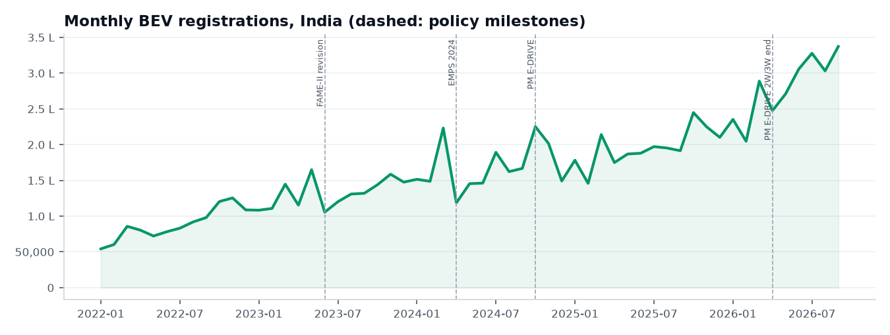
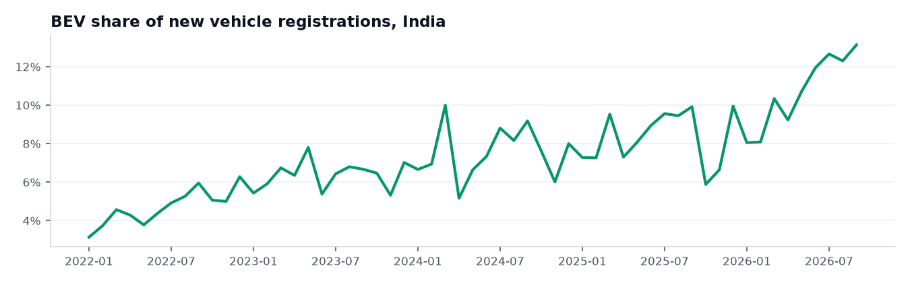
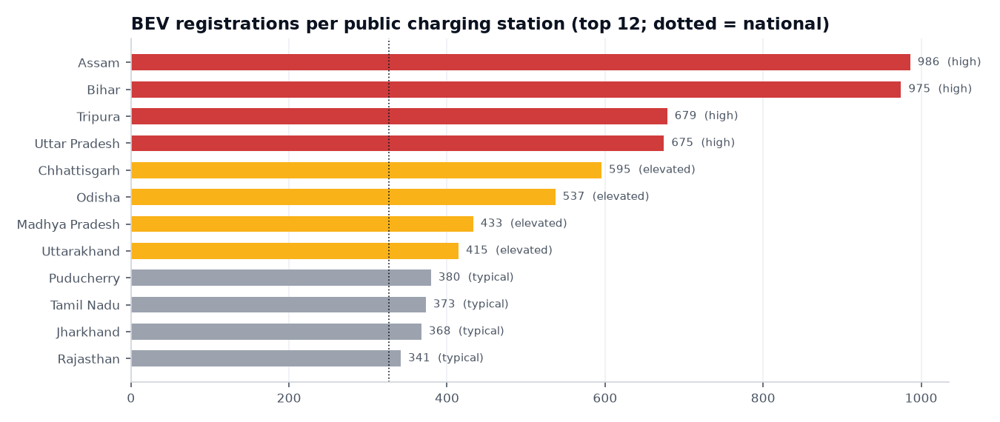
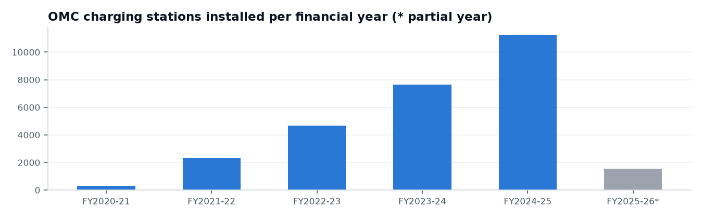

# VoltBharat — Analysis Report

_Generated 29 Oct 2026 15:15 by `etl/generate_reports.py` from the VoltBharat database (last ETL run 2026-10-29 09:07 UTC). Registration coverage 2022-01 to 2026-09._

All figures are computed by the same service code the dashboard uses. **EV = battery-electric vehicles (BEV)**: VAHAN fuel labels `Electric(BOV)` and `Pure EV`. See `reports/data_audit.md` for data quality and the exclusions applied (notably office HR207, a national aggregate mis-recorded as an RTO).

## 1. How are EV registrations growing?

- **95,43,592 BEVs** were registered from 2022-01 to 2026-09 (57 months), **7.48%** of 12,76,33,967 new registrations.
- Trailing 12 months (2025-10–2026-09): 32,01,718 BEVs, **+42.4%** vs 22,47,991 in the previous 12 months; share 8.10% → 9.61%.

| Financial year | Months in data | BEV | All registrations | EV share | BEV growth vs previous FY |
|---|---|---|---|---|---|
| FY2021-22 (partial) | 3 | 2,00,393 | 52,22,755 | 3.84% | n/a |
| FY2022-23 | 12 | 12,22,288 | 2,32,87,087 | 5.25% | n/a |
| FY2023-24 | 12 | 17,42,518 | 2,56,24,622 | 6.80% | +42.6% |
| FY2024-25 | 12 | 20,42,699 | 2,73,18,729 | 7.48% | +17.2% |
| FY2025-26 | 12 | 25,43,009 | 3,07,85,668 | 8.26% | +24.5% |
| FY2026-27 (partial) | 6 | 17,92,685 | 1,53,95,106 | 11.64% | n/a |

## 2. Which states lead?

| Rank | State | BEV registrations | EV share | Share rank | YoY growth (12 mo) |
|---|---|---|---|---|---|
| 1 | Uttar Pradesh | 15,69,042 | 9.03% | 8 | +13.0% |
| 2 | Maharashtra | 11,22,158 | 8.18% | 10 | +32.2% |
| 3 | Karnataka | 8,62,981 | 9.87% | 7 | +45.4% |
| 4 | Tamil Nadu | 6,64,435 | 6.92% | 15 | +67.0% |
| 5 | Rajasthan | 5,22,708 | 7.08% | 14 | +43.5% |
| 6 | Bihar | 5,07,788 | 7.77% | 11 | +47.8% |
| 7 | Madhya Pradesh | 4,96,816 | 6.57% | 17 | +47.6% |
| 8 | Kerala | 4,24,460 | 10.47% | 6 | +46.2% |
| 9 | Delhi | 4,17,740 | 12.10% | 2 | +7.2% |
| 10 | Gujarat | 4,00,996 | 4.45% | 24 | +58.5% |

Highest EV share (states with ≥10,000 registrations in the period):

| Share rank | State | EV share | BEVs |
|---|---|---|---|
| 1 | Tripura | 14.01% | 38,004 |
| 2 | Delhi | 12.10% | 4,17,740 |
| 3 | Assam | 11.81% | 3,39,202 |
| 4 | Goa | 11.78% | 46,025 |
| 5 | Chandigarh | 10.56% | 25,668 |
| 6 | Kerala | 10.47% | 4,24,460 |
| 7 | Karnataka | 9.87% | 8,62,981 |
| 8 | Uttar Pradesh | 9.03% | 15,69,042 |
| 9 | Odisha | 8.75% | 3,34,548 |
| 10 | Maharashtra | 8.18% | 11,22,158 |

## 3. Which vehicle categories contribute most?

**Not answerable with these sources.** The fuel-type source (the only source that identifies EVs) has no vehicle-category field, and the category and maker sources have no fuel field. Electric two-wheeler, three-wheeler, car, bus and goods-vehicle counts therefore cannot be derived.

What can be reported is the electrified powertrain mix (fuel-type source):

| Powertrain | Registrations | Share of electrified |
|---|---|---|
| Battery electric (BEV) | 95,43,592 | 97.41% |
| Strong hybrid | 2,53,771 | 2.59% |
| Plug-in hybrid | 141 | 0.00% |
| Fuel cell (hydrogen) | 26 | 0.00% |

All-fuel context (2022-01–2024-05, 29 validated states; NOT EV-specific):

| Category group | Registrations (all fuels) | Share |
|---|---|---|
| Two-wheelers | 3,45,37,579 | 71.63% |
| Light motor vehicles (cars/jeeps) | 89,69,993 | 18.60% |
| Three-wheelers | 19,88,504 | 4.12% |
| Goods vehicles | 19,10,849 | 3.96% |
| Passenger vehicles (buses/taxis) | 6,35,891 | 1.32% |
| Other | 1,71,188 | 0.36% |

## 4. Which manufacturers lead the EV market?

**EV market share by manufacturer cannot be computed.** The maker source has no fuel field, so a manufacturer's EV registrations cannot be separated from its petrol/diesel/CNG registrations. Figures below are ALL-FUEL.

Name-identified EV makers (Makers whose registered name contains 'Electric', 'EV', 'e-Mobility' or 'E-Motorad'. A name-based lower bound: it misses EV-only makers without such words in their name (and all EVs sold by mixed-fuel makers).) registered 27,75,222 vehicles, equal to 29.1% of BEV registrations in the fuel source — a lower bound only.

| Rank | Name-identified EV maker | Registrations |
|---|---|---|
| 1 | Ola Electric Technologies PVT LTD | 11,35,528 |
| 2 | Tata Passenger Electric Mobility LTD | 2,81,587 |
| 3 | Greaves Electric Mobility LTD | 1,89,491 |
| 4 | YC Electric Vehicle | 1,75,946 |
| 5 | Hero Electric Vehicles PVT. LTD | 1,31,373 |
| 6 | Saera Electric Auto PVT LTD | 1,16,298 |
| 7 | Dilli Electric Auto PVT LTD | 1,01,682 |
| 8 | Mahindra Electric Automobile LTD | 84,377 |
| 9 | Mini Metro EV L.L.P | 64,549 |
| 10 | Unique International EV PVT LTD | 55,143 |

## 5. Which states have the highest EV registrations relative to public chargers?

Indicator: BEVs registered 2022-01–2026-09 ÷ public stations in the 2025 snapshot. National: 326.0 BEVs per station. Approximate infrastructure pressure only; not utilisation, power or coverage. States with <25 stations are not ranked.

| Rank | State | BEVs per station | × national | BEVs | Stations | Tier |
|---|---|---|---|---|---|---|
| 1 | Assam | 986.1 | 3.02 | 3,39,202 | 344 | high |
| 2 | Bihar | 974.6 | 2.99 | 5,07,788 | 521 | high |
| 3 | Tripura | 678.6 | 2.08 | 38,004 | 56 | high |
| 4 | Uttar Pradesh | 674.6 | 2.07 | 15,69,042 | 2,326 | high |
| 5 | Chhattisgarh | 595.4 | 1.83 | 2,06,002 | 346 | elevated |
| 6 | Odisha | 537.0 | 1.65 | 3,34,548 | 623 | elevated |
| 7 | Madhya Pradesh | 433.1 | 1.33 | 4,96,816 | 1,147 | elevated |
| 8 | Uttarakhand | 414.6 | 1.27 | 92,453 | 223 | elevated |
| 9 | Puducherry | 379.6 | 1.16 | 18,982 | 50 | typical |
| 10 | Tamil Nadu | 373.1 | 1.14 | 6,64,435 | 1,781 | typical |
| 11 | Jharkhand | 367.5 | 1.13 | 1,29,724 | 353 | typical |
| 12 | Rajasthan | 341.4 | 1.05 | 5,22,708 | 1,531 | typical |

Sensitivity: using only the latest 12 months of registrations, the national ratio is 109.4 and the top five are Bihar (322.4), Assam (313.2), Odisha (227.5), Uttar Pradesh (198.0), West Bengal (193.4).

## 6. How has public charging infrastructure grown?

Charging stations installed by oil marketing companies (OMCs). Not the same as all public stations.

| Financial year | Installed | Cumulative | Growth vs previous FY |
|---|---|---|---|
| FY2020-21 | 314 | 314 | n/a |
| FY2021-22 | 2,344 | 2,658 | +646.5% |
| FY2022-23 | 4,658 | 7,316 | +98.7% |
| FY2023-24 | 7,649 | 14,965 | +64.2% |
| FY2024-25 | 11,246 | 26,211 | +47.0% |
| FY2025-26 (up to 1 Mar 2026) | 1,547 | 27,758 | n/a |

Total installed 27,737; reported operational 22,753; decommissioned 21. The 2025 state snapshot of all public stations is 29,277; the two measures are never added.

## 7. Registration trends around policy milestones

Six-month windows before and after each milestone (associations, not causal estimates):

| Milestone | Month | Avg monthly BEV before | after | Change | EV share before → after | After vs same months a year earlier |
|---|---|---|---|---|---|---|
| FAME-II begins | 2019-04 | — | — | — | — | Needs data from 2018-10 to 2019-09; available 2022-01 to 2026-09. |
| FAME-II revision | 2023-06 | 1,25,498 | 1,31,854 | +5.1% | 6.45% → 6.11% | +32.5% |
| FAME-II ends / EMPS 2024 begins | 2024-04 | 1,62,246 | 1,54,781 | -4.6% | 6.98% → 7.46% | +20.8% |
| EMPS 2024 ends / PM E-DRIVE begins | 2024-10 | 1,54,781 | 1,85,669 | +20.0% | 7.46% → 7.49% | +14.4% |
| PM E-DRIVE 2W/3W end | 2026-04 | 2,34,839 | 2,98,781 | +27.2% | 7.87% → 11.64% | +58.1% |
| PM E-DRIVE ends | 2028-04 | — | — | — | — | Needs data from 2027-10 to 2028-09; available 2022-01 to 2026-09. |

Caveats:

- A before/after difference is an association, not proof that a policy caused it.
- Other influences overlap these windows: new model launches, battery and fuel prices, state EV policies and road-tax waivers, festive-season demand (Oct-Nov), financial-year-end buying (March), supply constraints and pre-buying ahead of announced subsidy cuts.
- Several schemes overlap or follow each other directly (FAME-II ended 31 Mar 2024 and EMPS began 1 Apr 2024), so their effects cannot be separated with this data.
- Registrations are counted when vehicles are registered, which can lag sales.

## 8. Insights and recommendations

### Observations

- **National BEV registrations, trailing 12 months.** 32,01,718 battery-electric vehicles were registered in 2025-10–2026-09, up 42.4% from 22,47,991 in the preceding 12 months. (source: fuel)
- **EV share of new registrations.** BEVs were 9.61% of all new vehicle registrations in the latest 12 months, compared with 8.1% a year earlier (+1.51 percentage points). (source: fuel)
- **Fastest-growing states (BEV, trailing 12 months).** Highest year-over-year BEV growth among states with at least 1,000 BEV registrations in the comparison year: West Bengal +172.5% (64,102 → 1,74,654); Odisha +95.2% (72,588 → 1,41,724); Andhra Pradesh +90.9% (55,359 → 1,05,654). (source: fuel)
- **Highest EV adoption share.** In 2022-01–2026-09, the highest BEV shares of new registrations were Tripura 14.01%; Delhi 12.1%; Assam 11.81%, against a national 7.48%. Tripura's share is 1.87× the national level. (source: fuel)
- **Geographic concentration.** Five states — Uttar Pradesh, Maharashtra, Karnataka, Tamil Nadu, Rajasthan — account for 49.7% of the 95,43,592 BEV registrations in 2022-01–2026-09. (source: fuel)
- **Highest charging-infrastructure pressure.** Using BEVs registered in 2022-01–2026-09 and the 2025 public-station snapshot, the highest BEVs-per-station ratios are Assam 986.1 (3.02× national); Bihar 974.6 (2.99× national); Tripura 678.6 (2.08× national). The national ratio is 326.0. This indicates potential pressure, not utilisation or coverage. (source: fuel, chargers_state)
- **Lowest charging-infrastructure pressure.** The lowest BEVs-per-station ratios (states with at least 25 stations) are Nagaland 1.7; Arunachal Pradesh 6.5; Meghalaya 42.5. (source: fuel, chargers_state)
- **Monthly peak and latest month.** The latest month, 2026-09, was also the highest in the period: 3,37,311 BEV registrations (+76.1% vs the same month a year earlier). (source: fuel)
- **EV share trajectory.** Monthly BEV share of new registrations moved from 3.14% in 2022-01 to 13.13% in 2026-09. (source: fuel)
- **Electrified powertrain mix.** Strong hybrids (2,53,771), plug-in hybrids (141) and fuel-cell vehicles (26) together equal 2.7% of BEV volume; they are reported separately and are not counted as EVs in headline metrics. (source: fuel)
- **OMC charger installations.** Oil marketing companies installed 11,246 stations in FY2024-25 vs 7,649 in FY2023-24 (+47.0%). Cumulative OMC installations reached 27,737, of which 22,753 are reported operational. (source: chargers_omc)
- **Manufacturer concentration (all fuels).** The five largest manufacturers by ALL-FUEL registrations (Hero Motocorp LTD, Honda Motorcycle and Scooter India (P) LTD, TVS Motor Company LTD, Bajaj Auto LTD, Maruti Suzuki India LTD) hold 67.56% of all registrations. EV market share by maker cannot be computed from this source. (source: maker)

### Recommendations

- **Prioritise charging-capacity reviews.** Review public charging capacity first in Assam, Bihar, Tripura, Uttar Pradesh, Chhattisgarh: each has a BEVs-per-station ratio at least 1.25× the national level and growing BEV registrations. _Reasoning: A high ratio combined with rising registrations suggests demand on public stations may be growing faster than supply. Confirm with utilisation, charger-power and location data before investing; home and workplace charging are not captured here._ (source: fuel, chargers_state)
- **Study high-adoption states.** Compare state policies and market structure in Tripura, Delhi, Assam with lower-share states to identify transferable measures. _Reasoning: These states show the highest BEV shares; the data cannot attribute this to any single cause._ (source: fuel)
- **Close the data gaps.** Obtain registrations by fuel AND vehicle category (or by fuel AND maker) and a dated, point-level charger dataset with power ratings. These would enable EV segment analysis, EV market share by maker, and true accessibility metrics. _Reasoning: Current sources cannot separate EVs by category or manufacturer, and the charger data is a single state-level snapshot._ (source: fuel, maker, category, chargers_state)

## Limitations

- **Vehicle registrations by fuel type**: Office HR207 (a national aggregate mis-recorded as an office) is excluded. BEV label changed from 'Electric(BOV)' to 'Pure EV' during 2024; both are counted as BEV. No vehicle-category field, so EV registrations cannot be split into 2W/3W/4W/bus. VAHAN may not include every registering authority in every month.
- **Vehicle registrations by maker**: No fuel field: cannot compute EV market share by manufacturer. Manufacturers selling both EVs and ICE vehicles cannot be split. Office HR207 is excluded.
- **Vehicle registrations by vehicle category**: No fuel field: cannot identify EVs. Contains aggregate values leaked into office rows; an outlier rule removes them and states whose cleaned totals differ from the fuel file by >5% are flagged. Telangana and Lakshadweep are absent. Coverage ends May-2024.
- **Public EV charging stations by state (2025)**: Single snapshot without an exact as-of date beyond 2025. Counts stations, not charging points, power rating, utilisation or uptime. No geographic coverage within states.
- **EV charging stations installed by oil marketing companies, by financial year**: Covers OMC-installed stations only; never added to the state snapshot. FY2025-26 is partial. 'total_installed' is net of decommissioned stations in some rows; 'Leh' row merged into Ladakh.
- State boundaries in the map are community-curated (not an official Survey of India product).
